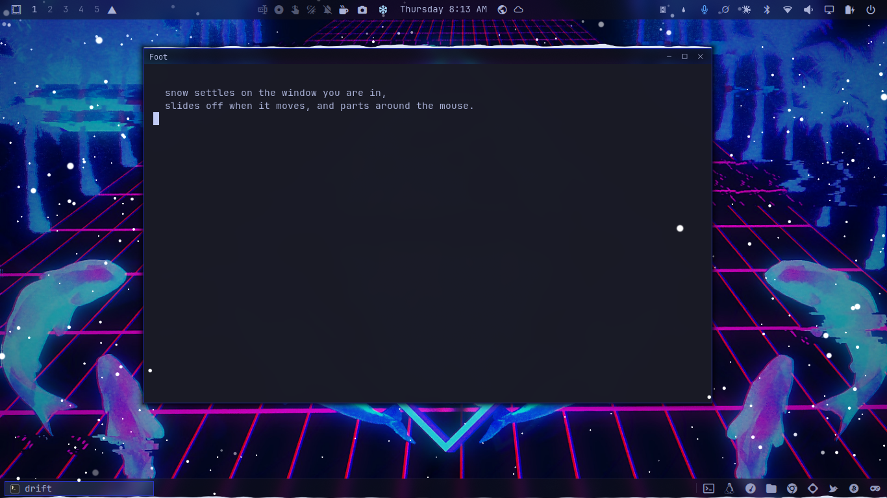
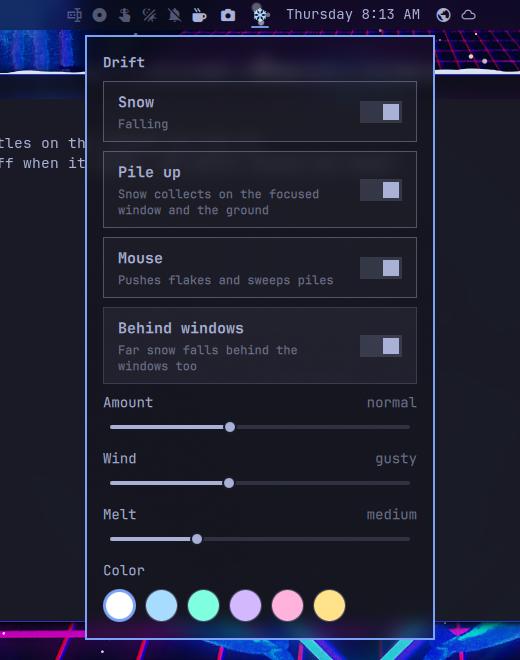

# drift

Snow on a Hyprland desktop, made with Quickshell.



- **Three depths.** Small far flakes fall behind the windows. Bigger ones fall in front, and the biggest sway and blow about in the gusts.
- **It settles.** Snow piles up on the top of the window you are in and along the bottom of the screen. It slides off when the window moves, closes or loses focus, and it melts.
- **The mouse** pushes flakes aside and sweeps settled snow off an edge.
- **Clicks go straight through it.**
- **Light on the machine.** Most flakes are moved by the graphics chip, not the processor. drift runs at low priority, falls thinner when other programs keep the processor busy, stops falling when they keep it very busy, and draws nothing while a window is fullscreen.

## Needs

- Hyprland
- [Quickshell](https://quickshell.org) (made on 0.3.2), with Qt 6's QtQuick.Particles (part of `qt6-declarative`)
- Python 3

## Install

```
git clone https://github.com/samruger/drift ~/.local/share/drift
install -m 755 ~/.local/share/drift/drift.sh ~/.local/bin/drift
```

`drift` turns the snow on, and off again. It looks for `shell.qml` in `$DRIFT_DIR`, beside the script, or in
`~/.local/share/drift`.

```
drift                    snow on or off
drift mouse [on|off]     the mouse pushing flakes and sweeping settled snow
drift behind [on|off]    the far snow, behind the windows
```

Without `on` or `off`, those two switch over.

In top and btop it is called `drift`, and its helper, which asks Hyprland where the mouse and windows are, `drift-ipc`.

## Settings

`~/.config/drift/settings.json`. The snow follows changes as soon as the file is saved.

| Key | Default | What it is |
|---|---|---|
| `amount` | `1.0` | how much snow: 0 is none, 3 is a blizzard |
| `wind` | `1.0` | how hard the gusts blow: 0 is still |
| `settle` | `true` | snow piles up on the window you are in and on the ground |
| `cursor` | `true` | the mouse pushes flakes and sweeps piles |
| `behind` | `true` | far snow falls behind the windows (off is lighter on the processor) |
| `melt` | `0.3` | how fast settled snow melts: 0 is never |
| `color` | `"#ffffff"` | the snow's colour |

## On the Omarchy bar



`omarchy/` has a snowflake for the [Omarchy](https://omarchy.org) shell's bar. A click turns the snow on or off. A right
click opens the menu above, which writes `settings.json`.

```
cp ~/.local/share/drift/omarchy/*.qml ~/.config/omarchy/bar/modules/
```

Then add `{ "id": "drift", "type": "qml" }` to the bar in `~/.config/omarchy/shell.json`, right after
`omarchy.indicators`, and run `omarchy restart shell`. The snowflake is made like the indicators (the reminder,
notifications, night light): dim while the snow is off, lit while it falls.

For a keybind, the menu and the snow are reachable over Quickshell's IPC:

```
qs ipc -p /usr/share/omarchy/shell call drift menu
qs ipc -p /usr/share/omarchy/shell call drift toggle
```

## Files

| File | What it is |
|---|---|
| `shell.qml` | the snow: the falling flakes, the piles and the wind |
| `ipc.py` | asks Hyprland where the mouse, the windows and the screens are, and how busy the processor is |
| `drift.sh` | the `drift` command |
| `omarchy/` | the snowflake and its menu, for the Omarchy bar |

## License

AGPL-3.0. See `LICENSE`.
